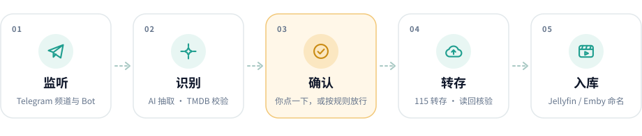

<div align="center">


# Reelay

**Turn the releases that scroll past in Telegram into an organized media library on your 115 drive.**

Self-hosted · AI recognition · You decide · Every transfer verified

[](https://github.com/Derrors/reelay/releases)
[](https://github.com/Derrors/reelay/actions/workflows/ci.yml)
[](https://github.com/Derrors/reelay/pkgs/container/reelay)

[](LICENSE)

[简体中文](README.md) · **English**

<br>

<picture>
  <source media="(prefers-color-scheme: dark)" srcset="docs/assets/flow-dark.svg">
  
</picture>

</div>

<br>

The channels and bots you follow post a flood of releases every day, and you only want a few of them. Reelay watches them with your own Telegram account. An LLM reads each message to work out the title, season, episodes and release details, and TMDB plus the actual files in the share double-check it. When you tap **Save** in Telegram, Reelay saves the share into your own 115 cloud drive and renames and files it the way Jellyfin / Emby expect. The next time you open your media server, the new episode is already there.

Set it up once in the web console; after that, approving, correcting, following shows and reading the daily report all happen in Telegram.

> **Reel** + **Relay**: relaying releases from your message feed into your library.

> [!NOTE]
> The web console, Telegram messages and the documentation are in **Simplified Chinese**. The examples below are translated.

## ✨ Highlights

<table>
<tr>
<td width="33%" valign="top">

### 🧠 Understands messages
AI reads title, episodes and release details; TMDB fixes the title. Rules take over when AI is down.

</td>
<td width="33%" valign="top">

### 📱 Done in Telegram
Save, reroute or follow a show in one tap; fix a wrong match with one line.

</td>
<td width="33%" valign="top">

### 🛡️ Transfers you can trust
Checkpoint before every call, verify after. Uncertain results are re-checked, never re-sent.

</td>
</tr>
<tr>
<td valign="top">

### 🗂️ Organized on arrival
Auto-filed and renamed by template; duplicates go to you, are skipped, kept, or upgraded.

</td>
<td valign="top">

### 📺 Follows shows for you
New episodes save themselves, missing ones are flagged daily, and finished seasons unsubscribe.

</td>
<td valign="top">

### 🧩 Works everywhere
Web console, Telegram bot and MCP; one folder is one plugin.

</td>
</tr>
</table>

## 💬 What it looks like in Telegram

<table>
<tr>
<th width="50%">Approval card</th>
<th width="50%">Saved notification</th>
</tr>
<tr>
<td valign="top">

```text
🖼 (TMDB backdrop)
📺 The Long Season (2023) · S01 E01-E10

🌟 Rating: 8.6
🎭 Genre: Drama · Mystery · Crime
🌍 Region: Mainland China
👥 Cast: Fan Wei, Qin Hao, Chen Minghao
🖥 Resolution: 2160p · Dolby Vision
💬 Subtitles: Simplified Chinese
📦 Size: 38.6 GB

📖 Overview:
▍ In 1997, taxi driver Wang Xiang… (expandable)

📂 Save to: /TV/Chinese TV
📡 Source: @example_channel

[ ✅ Save   ]  [ 🚫 Ignore      ]
[ 📂 Folder ]  [ ✏️ Fix         ]
[ 🔔 Follow ]  [ ⛔ Stop receiving ]
[ 🎬 TMDB details                ]
```

</td>
<td valign="top">

```text
🖼 (TMDB backdrop)
✅ Saved

📺 The Long Season (2023) · S01 E01-E10

🌟 Rating: 8.6
🎭 Genre: Drama · Mystery · Crime
🖥 Resolution: 2160p · Dolby Vision
📦 Size: 38.6 GB

📂 Location: /TV/Chinese TV/The Long Season
   (2023) [tmdbid=…]/Season 01
📄 Files: 10, The Long Season - S01E01 -
   第 1 集 - 2160p H265.mkv, The Long Season
   - S01E02 - 第 2 集 - 2160p H265.mkv …

[ 🎬 TMDB details ]
```

</td>
</tr>
</table>

What you can do without opening the web console:

| When | In Telegram |
| --- | --- |
| Recognition is wrong | Tap **✏️ Fix** on the card and send one line such as `title Blossoms season 2`; anything you leave out stays the same. Or ask for re-recognition |
| A transfer or organize step stops | The alert offers the right buttons: verify the transfer, continue with what arrived, reorganize, delete or overwrite, retry |
| Things piled up | `/pending` opens each card, or approves / ignores everything at once |
| Following shows | `/subs` shows what's saved and missing, cancels or resumes subscriptions and handles suggestions; missing-episode reminders can be marked "don't wait" |
| Never want a title again | Tap **⛔ Stop receiving** on the card; `/ignored` brings it back |
| How is it running | `/status` for an overview; a daily report arrives every day |
| Just ask | With AI configured: "What's pending?", "Approve these episodes of X and save them to Anime" |

Re-scanning the QR code after the 115 login expires, and all configuration, happen in the web console. See the [Telegram and agents guide](docs/agents.md).

## 🚀 Quick start

All you need is Docker and a `compose.yaml`. Images are published for amd64 and arm64:

```bash
mkdir reelay && cd reelay
curl -fsSLO https://raw.githubusercontent.com/Derrors/reelay/main/compose.yaml
docker compose pull
docker compose up -d web          # console at http://127.0.0.1:28080
```

Fill in Telegram, AI and 115 under **Settings** in the console, then log in with your personal Telegram account and start listening:

```bash
docker compose run --rm --no-deps -it worker python -m reelay.login
docker compose up -d
```

Then add the channels or bots to watch under **Settings → Sources**: paste a few sample messages, let AI draft the source's rules, and tap **Test recognition** on the card to check the result. Where to get each account and how to verify your first release is covered in the [quick start](docs/quickstart.md) (Chinese).

<details>
<summary><b>Without Docker, or try a simulation first</b></summary>

<br>

Simulation mode runs the whole pipeline with a built-in config, sample messages and an in-memory drive. It reads none of your local config or secrets and needs no accounts:

```bash
git clone https://github.com/Derrors/reelay && cd reelay
python3.12 -m venv .venv && source .venv/bin/activate
pip install -e .
python -m reelay.main --dry-run
```

Running directly on your machine:

```bash
pip install -e ".[all]"
(cd web && npm ci && npm run build)
python -m reelay.web       # web console
python -m reelay.login     # log in with your personal Telegram account
python -m reelay.main      # listener and background worker (separate terminal)
```

</details>

## 🎞️ What the library looks like

Filed by category by default (or by media type, or flat). Naming templates are editable in the console, and **Preview organizing** shows the result before you save. The default episode template adds the Chinese episode label 第 N 集 ("episode N"); remove it from the template if you don't want it:

```text
Movies/
└── Chinese Movies/
    └── The Wandering Earth II (2023) [tmdbid=…]/
        └── The Wandering Earth II (2023) - 2160p H265.mkv
TV/
└── Chinese TV/
    └── The Long Season (2023) [tmdbid=…]/
        └── Season 01/
            ├── The Long Season - S01E01 - 第 1 集 - 2160p H265.mkv
            └── The Long Season - S01E02 - 第 2 集 - 2160p H265.mkv
Anime/
└── Japanese Anime/
    └── …
Other/
└── Documentaries/
    └── …
```

## 🧭 Design

**AI proposes → sources of truth verify → you decide → your decisions feed back to the AI.**

AI reads messages and makes suggestions; TMDB and the real files in the share keep it honest, and anything uncertain goes to you. Every fix you make on a card makes the next recognition from the same source more accurate. Transferring, renaming and deduplication are always done by deterministic code and verified by reading back. See [architecture](docs/architecture.md) (Chinese).

## 📚 Documentation

The documentation is in Chinese.

| Document | Contents |
| --- | --- |
| [Quick start](docs/quickstart.md) | Accounts, first launch, initial setup, verifying your first release |
| [Deployment](docs/deployment.md) | Docker, access and security, upgrades and rollback, backups, health checks and recovery |
| [Configuration](docs/configuration.md) | System settings, per-source recognition rules, plugin settings, secrets and runtime files |
| [Telegram and agents](docs/agents.md) | Control bot buttons, commands and chat; MCP for Claude and other agents |
| [Plugins](docs/plugins.md) | Extension points, PipelineContext, calling AI, metadata conventions |
| [Architecture](docs/architecture.md) | State machine, how AI and rules divide the work, transfer and recovery boundaries |
| [Changelog](CHANGELOG.md) | What changed in each release |

## 📌 Status

> [!NOTE]
> 1.0. The author uses it daily, and the full manual-approval flow runs continuously on a real account. From 1.0 on the project follows semantic versioning: config and data formats stay compatible within 1.x. Feedback is welcome, especially on automatic approval and running many sources. Runs on macOS / Linux; on Windows, use Docker.

> [!WARNING]
> Reelay does not provide or index any content. It only processes messages your own account can see and saves to your own drive. Automating a personal Telegram account may get it **banned**, and calling 115 APIs too often may trigger **rate limits or risk control**. Read the [disclaimer](DISCLAIMER.md) (Chinese) before use.

## 🤝 Contributing

Issues and PRs are welcome. See [CONTRIBUTING](CONTRIBUTING.md) for the development setup and commit conventions, and report security issues privately as described in [SECURITY](SECURITY.md).

## License

[MIT](LICENSE) © Derrors
