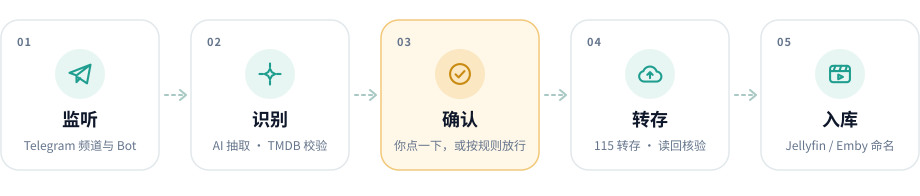

<div align="center">


# Reelay

**Turn Telegram resource messages into an organized media library on your 115 drive.**

Self-hosted · AI / rules · Approval & subscriptions · Verified transfers · Automatic organizing

[](https://github.com/Derrors/reelay/releases)
[](https://github.com/Derrors/reelay/actions/workflows/ci.yml)
[](https://github.com/Derrors/reelay/pkgs/container/reelay)

[](LICENSE)

[简体中文](README.md) · **English**

[Documentation](https://derrors.github.io/reelay/) · [Quick start](https://derrors.github.io/reelay/quickstart.html) · [User guide](https://derrors.github.io/reelay/user-guide.html) · [Releases](https://github.com/Derrors/reelay/releases) · [Issues](https://github.com/Derrors/reelay/issues)

<br>

<picture>
  <source media="(prefers-color-scheme: dark)" srcset="docs/assets/flow-dark.svg">
  
</picture>

</div>

## Overview

Reelay is a **self-hosted Telegram → 115 resource organizer** for a NAS or home server. It monitors sources with your own Telegram account, identifies titles, episodes and release details, then transfers, verifies and organizes approved resources into your own 115 drive.

Configure it in the web console; approve, correct and follow shows from the web or Telegram. **Reel + Relay**: relaying resources from your message feed into your library.

> Reelay does not search the web for resources or missing episodes, provide playback, mount your drive, or generate STRM files. Your media server needs its own way to read files on 115. [Full capabilities and boundaries →](https://derrors.github.io/reelay/introduction.html)

The web console, Telegram messages and detailed guides are in **Simplified Chinese**.

## Highlights

- **Recognition and filtering**: AI or rules, TMDB matching, 115 shares and eD2k links, with per-source filters.
- **You decide**: approve individually or in batches, allow eligible resources automatically, and correct or re-run recognition.
- **Season subscriptions**: allow eligible new episodes; episode tracking adds missing-episode reminders. Subscriptions-only filtering is supported from v1.5.0.
- **Verified transfers**: checkpoint before transferring and verify uncertain results rather than blindly resubmit. eD2k uses 115 cloud downloads, not the host's disk.
- **Automatic organizing**: categories, naming templates, previews and duplicate-version handling, with Jellyfin / Emby-friendly naming.
- **Multiple interfaces**: web console, Telegram control bot and MCP, plus plugins and amd64 / arm64 Docker images.

## Quick start

Prepare an always-on machine, Docker Compose **v2.24+**, a personal Telegram account with API ID / API Hash, and a 115 account. See the [prerequisites](https://derrors.github.io/reelay/quickstart.html#开始前的准备) for AI, TMDB and control-bot setup.

**1. Start the web console:**

```bash
mkdir reelay && cd reelay
curl -fsSLO https://raw.githubusercontent.com/Derrors/reelay/main/compose.yaml
docker compose pull
docker compose up -d web
```

**2. Open [http://127.0.0.1:28080](http://127.0.0.1:28080)**, set a console password, then configure networking, Telegram, AI / TMDB and 115 under Settings.

The port listens only on the deployment machine by default. For a NAS or LAN, follow the [access instructions](https://derrors.github.io/reelay/quickstart.html#2-打开管理台); do not expose it directly to the internet.

**3. In the same directory, log in with your personal Telegram account and start the worker:**

```bash
docker compose run --rm --no-deps -it worker python -m reelay.login
docker compose up -d
```

**4. Set save directories and sources.** Begin with manual approval and rule-based decisions. Test a message you are authorized to save, then wait for a new message, approve it and verify that the files arrive.

Step-by-step checks, local installation and offline simulation are in the **[quick start](https://derrors.github.io/reelay/quickstart.html)**.

## Documentation

Detailed guides are in Chinese.

| Goal | Guide |
| --- | --- |
| Configure sources, approvals, subscriptions and organizing | [User guide](https://derrors.github.io/reelay/user-guide.html) |
| Troubleshoot access, messages or transfers | [FAQ](https://derrors.github.io/reelay/faq.html) |
| Look up settings, upgrade or back up | [Configuration](https://derrors.github.io/reelay/configuration.html) · [Deployment](https://derrors.github.io/reelay/deployment.html) |
| Use the bot, natural-language controls or MCP | [Telegram and agents](https://derrors.github.io/reelay/agents.html) |
| Understand internals or build extensions | [Architecture](https://derrors.github.io/reelay/architecture.html) · [Plugins](https://derrors.github.io/reelay/plugins.html) |

## Before you use it

- Documentation follows the source tree; **unreleased features are not yet in the release image**. Check [Releases](https://github.com/Derrors/reelay/releases) and the [changelog](CHANGELOG.md).
- AI features send relevant content to your configured endpoint; third-party services may charge fees. The data directory contains credentials and login sessions: protect it, back it up in full and never upload it publicly.
- Only process content you are authorized to use. Automation may trigger Telegram account restrictions or 115 risk controls. Read the [disclaimer](DISCLAIMER.md) before use.

## Contributing

Issues and PRs are welcome. See [CONTRIBUTING](CONTRIBUTING.md), report security issues privately as described in [SECURITY](SECURITY.md), and keep credentials, cookies and sessions out of reports.

[MIT](LICENSE) © Derrors
