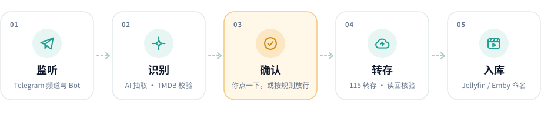

<div align="center">


# Reelay

**把 Telegram 消息里的影视资源，转存成 115 网盘中整理好的媒体库。**

监听来源 · AI / 规则识别 · 审批与追剧 · 转存核验 · 自动整理

[](https://github.com/Derrors/reelay/releases)
[](https://github.com/Derrors/reelay/actions/workflows/ci.yml)
[](https://github.com/Derrors/reelay/pkgs/container/reelay)

[](LICENSE)

**简体中文** · [English](README.en.md)

[在线文档](https://derrors.github.io/reelay/) · [快速开始](docs/quickstart.md) · [使用指南](docs/user-guide.md) · [常见问题](docs/faq.md) · [全部文档](docs/README.md) · [版本发布](https://github.com/Derrors/reelay/releases) · [问题反馈](https://github.com/Derrors/reelay/issues)

<br>

<picture>
  <source media="(prefers-color-scheme: dark)" srcset="docs/assets/flow-dark.svg">
  
</picture>

</div>

<!-- #region introduction -->

## 简介

你关注的频道、群组和 Bot 每天发来很多资源，但你真正想保存的可能只有几部。手动找到链接、判断是不是缺的那一集、转存到网盘、改名、归类，反复做起来很费时间。

Reelay 是一个**自托管的 Telegram → 115 资源整理工具**。它用你自己的 Telegram 账号监听指定来源，通过 AI 或规则识别消息里的片名、季集与版本，再结合 TMDB 和资源中的文件信息进行检查。符合条件的资源由你确认，或按规则自动放行，最后转存到自己的 115 账号，核验文件并整理目录。

你可以在网页管理台完成配置，也可以用 Telegram 控制 Bot 处理日常审批、修正识别、订阅剧集和查看提醒。不必一直开着浏览器，但后台服务需要持续运行。

> **Reel**（胶片）+ **Relay**（接力）：把资源从消息流接力到媒体库。

### 适合谁

- **在 NAS 或家用服务器上整理媒体库的人**：希望少做重复的转存、改名和归类。
- **从多个 Telegram 来源收集资源的人**：希望统一筛选和审批，而不是逐个频道翻消息。
- **追更剧集的人**：希望订阅后的新集按规则转存，并知道哪些集还没入库。
- **偏好自己掌控自动化的人**：既可以逐条确认，也可以逐步放开自动处理。

### 它不是什么

| 你可能期待的能力 | Reelay 的实际边界 |
| --- | --- |
| 搜索全网影视资源 | 不提供资源搜索引擎，也不内置资源库；只处理你配置的来源消息。TMDB 搜索用于识别作品和建立订阅，不是搜索下载链接 |
| 自动补齐所有缺集 | 可以记录订阅、发现缺集，并处理之后收到的资源；不会主动到全网寻找缺集 |
| 多网盘通用转存器 | 当前内置的真实存储目标是 **115**，不是百度网盘、阿里云盘、Google Drive 或 OneDrive 的转存工具 |
| 本地下载器 | 115 分享走网盘转存；电驴链接交给 **115 云下载**，不是下载到运行 Reelay 的机器 |
| 安装后直接播放 | 不提供播放器、网盘挂载、STRM 生成或 Jellyfin / Emby 服务；媒体服务器如何读取 115 文件，需要你另行配置 |
| 无人值守且永不出错 | AI 可能识别错，第三方接口也可能限流或失效；拿不准或核验不过时会停止自动处理，交给你确认 |

## 功能特性

### 识别与筛选

- **多来源监听**：支持个人账号可访问的 Telegram Bot、频道和群组；一张来源卡片可填写多个来源，共用设置。
- **AI 与规则两种识别方式**：识别片名、年份、季、集、清晰度等；可为不同来源编写自己的字段规则，也可让 AI 根据样例起草。
- **TMDB 补全**：匹配作品、规范片名，补充类型、国家地区、海报等信息，减少同名作品混淆。
- **115 分享与电驴链接**：识别正文和消息按钮中的链接；同时提取到 115 分享与电驴链接时优先使用分享。
- **确定性过滤与自然语言偏好**：按关键词、类型、地区、清晰度过滤；需要时再由 AI 按收藏偏好收紧处理结果。
- **先试后存**：来源卡片的「测试识别」支持试跑尚未保存的修改，不创建转存任务。

### 审批与追剧

- **逐条或批量审批**：通过管理台或 Telegram 控制 Bot 转存、忽略、修正识别和更换目标目录。
- **订阅新集放行**：已订阅作品的对应季，在置信度、过滤与去重等检查通过后可以自动转存。
- **仅处理订阅（未发布）**：可全局开启或按来源单独设置；未订阅、订阅已结束或无法确认属于有效订阅的资源直接忽略。
- **不再接收某部作品**：不同于只忽略一条消息，可以持续屏蔽这部作品，之后也能恢复。
- **缺集提醒与日报**：启用对应插件后查看已入库与缺失的集；每日巡检确认播完、收齐并满足完结条件后自动结束订阅。

### 转存与整理

- **转存前后有核验**：先记录检查点，再请求网盘转存；读回确认文件后才进入整理。
- **结果不明时不盲目重发**：先核验已有结果，避免重复转存；临时错误、登录失效和风控按不同方式处理。
- **自动分类与命名**：按媒体类型或二级分类建立目录，支持命名模板和整理效果预览。
- **重复与版本冲突处理**：可以转人工、保留旧文件、并存，或按版本偏好洗版；涉及删除或替换的策略需谨慎开启。

### 管理与扩展

- **Web、Telegram、MCP 三种入口**：管理台适合配置和排查，Telegram 适合日常操作，MCP 可供外部 Agent 查询或管理。
- **数据保存在本地**：配置、数据库、密钥和会话集中在数据目录，便于备份和迁移。
- **插件扩展**：识别补全、分享读取、整理、追更和日报等能力通过插件组织，可添加自己的扩展。
- **Docker 部署**：提供 amd64 / arm64 镜像；也可在 macOS / Linux 上从源码运行，Windows 推荐 Docker。

<!-- #endregion introduction -->

> [!NOTE]
> 文档跟随当前仓库源码更新。标注「未发布」的功能尚未进入正式镜像；使用 `latest` 或固定版本时，请以 [Releases](https://github.com/Derrors/reelay/releases) 和 [更新日志](CHANGELOG.md) 为准。

## 一条资源如何入库

| 步骤 | Reelay 做什么 | 你在哪里查看或操作 |
| --- | --- | --- |
| 1. 收到消息 | 监听已配置来源的新消息并落库 | 管理台「任务」 |
| 2. 识别资源 | 提取链接和作品信息，进行 TMDB 匹配、分享检查与过滤 | 来源「测试识别」、任务处理轨迹 |
| 3. 决定是否保存 | 不符合条件的忽略，拿不准的待审批，符合自动放行条件的进入队列 | 管理台「待审批」或 Telegram 卡片 |
| 4. 转存到 115 | 115 分享转存，或把电驴链接交给 115 云下载；随后核验文件 | 任务详情、必要时的异常提醒 |
| 5. 整理入库 | 分类、改名、移动并读回核验 | 管理台「媒体库」、115 目录、入库通知 |

**“已批准”不等于“已入库”**。只有转存与整理完成、任务显示「已入库」后，才算走完这条流程。

## 快速开始

### 1. 准备这些东西

| 项目 | 是否需要 | 用途 |
| --- | --- | --- |
| 一台可持续运行的机器 | 必需 | NAS、家用服务器或其他可运行 Docker 的设备 |
| Docker 与 Compose v2.24+ | Docker 方式必需 | 启动管理台与后台服务 |
| Telegram 个人账号及 API ID / API Hash | 必需 | 读取该账号能看到的来源消息，不是控制 Bot 的 Token |
| 115 账号 | 必需 | 接收转存、云下载与整理后的文件 |
| 控制 Bot Token 和你的 Telegram 数字 ID | 推荐 | 在 Telegram 接收卡片、审批和查看告警 |
| OpenAI 兼容的 AI 接口 | 推荐 | AI 识别、生成规则和自然语言操作；也可选择规则识别 |
| TMDB API Key 或 Read Access Token | 推荐；订阅匹配需要 | 确认作品身份，补全规范信息与海报 |

账号从哪里申请、分别填在哪里，见 [完整快速开始](docs/quickstart.md)。

### 2. 启动管理台

```bash
mkdir reelay && cd reelay
curl -fsSLO https://raw.githubusercontent.com/Derrors/reelay/main/compose.yaml
docker compose pull
docker compose up -d web
```

在部署机器上打开 **http://127.0.0.1:28080**，先设置管理台密码，然后在「设置」中配置网络、Telegram、AI / TMDB 和 115。

> [!TIP]
> 在 NAS 或另一台服务器上部署时，浏览器里的 `127.0.0.1` 指的是你正在使用浏览器的设备。默认端口仅监听部署机器本机；局域网访问方式见 [快速开始：打开管理台](docs/quickstart.md#打开管理台)。不要为了方便直接把管理台暴露到公网。

### 3. 登录个人 Telegram 账号并启动后台

在 `compose.yaml` 所在目录执行：

```bash
docker compose run --rm --no-deps -it worker python -m reelay.login
docker compose up -d
```

按终端提示输入手机号、验证码；开启两步验证时还需输入密码。登录的是**用于读取消息的个人账号**，不是控制 Bot。

### 4. 添加来源并验证第一条资源

1. 在 Telegram 中先关注频道、加入群组，或与目标 Bot 建立对话。
2. 在「设置 → 基础」配置保存目录。
3. 在「设置 → 监听来源」添加 `@example_channel`，先选择「人工确认」；希望连订阅也逐条确认时，放行方式选「规则判断」。
4. 点「测试识别」，贴一条你有权保存的资源消息，核对片名、季集、链接和处理结果。
5. 保存来源设置，等待一条新消息进入「待审批」，核对后转存。
6. 确认任务显示「已入库」，并在 115 检查文件路径。

新来源默认不导入添加前的历史消息；「测试识别」只预览，不会真的转存。

➡️ 逐步操作、每一步的成功标志与推荐设置，见 [快速开始](docs/quickstart.md)。

<details>
<summary><b>不想先配置账号？可以离线模拟体验</b></summary>

模拟运行使用内置样例和内存网盘，不读取本机配置与密钥，不访问真实账号：

```bash
git clone https://github.com/Derrors/reelay && cd reelay
python3.12 -m venv .venv
source .venv/bin/activate
pip install -e .
python -m reelay.main --dry-run
```

看到 `冒烟判定：✅ PASS` 表示模拟流程完成，不代表真实 Telegram、AI 或 115 已经配置成功。

从源码运行真实服务需要安装完整依赖并构建管理台，见 [快速开始：本机运行](docs/quickstart.md#本机运行)。

</details>

## 日常怎么用

| 我想做什么 | 从哪里开始 |
| --- | --- |
| 每条资源都自己决定 | 「人工确认」+「规则判断」，在待审批中逐条核对 |
| 在追的剧自动收，其他的问我 | 「人工确认」+「规则 + 订阅放行」，再添加剧集订阅 |
| 只接收已订阅的剧 | 开启「仅处理订阅」（未发布），先确认已添加有效订阅且 TMDB 可用 |
| 某个可信来源尽量自动处理 | 先试跑并核对，再把确认方式改为「AI 处理」；拿不准的仍会转人工 |
| 片名、季或集识别错了 | 在待审批卡片修正；同一来源反复出错时调整来源识别规则 |
| 某部作品以后都不要 | 选择「不再接收」，不是只忽略当前消息 |
| 转存或整理停住了 | 打开任务详情看原因，按提示核验、重新整理或重试，不要反复新建相同任务 |

> **三个容易混淆的设置**：
> 「识别方式」决定怎么读消息；「确认方式 / 放行方式」决定这条资源是否转存；「仅处理订阅」决定未订阅资源是否直接排除。它们不是同一个开关。

完整操作与推荐组合见 [使用指南](docs/user-guide.md)，问题排查见 [常见问题](docs/faq.md)。

## 整理后的目录示例

以下是**示意目录**，实际目录由作品信息、分类和命名模板决定；匹配到 TMDB 时会写入对应 ID：

```text
电影/
└── 国产电影/
    └── 示例电影 (2026) [tmdbid=…]/
        └── 示例电影 (2026) - 2160p H265.mkv
剧集/
└── 国产剧集/
    └── 示例剧集 (2026) [tmdbid=…]/
        └── Season 01/
            ├── 示例剧集 - S01E01 - 第 1 集 - 1080p H265.mkv
            └── 示例剧集 - S01E02 - 第 2 集 - 1080p H265.mkv
```

命名格式面向 Jellyfin / Emby 等媒体库的刮削习惯；**Reelay 不负责把 115 挂载到媒体服务器，也不负责触发播放**。目录、模板和同名文件处理见 [使用指南：保存目录与整理](docs/user-guide.md#保存目录与整理)。

## 数据、费用与安全

- **自托管不等于所有处理都在本机**：AI 功能会把相关消息或上下文发送到你配置的 AI 接口；TMDB 匹配会查询作品信息；转存和云下载发生在 115。
- **项目免费开源，第三方服务可能收费**：AI Token、服务器、网盘容量或云下载权益等由对应服务决定。
- **数据目录需要妥善保护**：其中包括数据库、密钥、Telegram 登录会话和 115 凭证，不要公开上传。备份时保留整个目录，而不只是配置文件。
- **自动化有账号风险**：个人 Telegram 账号可能受限，115 也可能触发风控；限流和核验能减少问题，但不能保证账号或文件绝对安全。
- **只处理有权使用的内容**：Reelay 不提供、不索引、不分发资源。使用前请阅读 [免责声明](DISCLAIMER.md)。

## 文档导航

| 阅读目标 | 文档 |
| --- | --- |
| 第一次了解项目、选择阅读路线 | [文档首页](docs/README.md) |
| 从零部署，走通第一条资源 | [快速开始](docs/quickstart.md) |
| 配来源、审批、追剧、整理、处理异常 | [使用指南](docs/user-guide.md) |
| 页面打不开、没收到消息、没自动转存等问题 | [常见问题](docs/faq.md) |
| 升级、回滚、备份、迁移、反向代理 | [部署与运维](docs/deployment.md) |
| 查询某个配置项的默认值和含义 | [配置参考](docs/configuration.md) |
| 控制 Bot 命令、自然语言与 MCP | [Telegram 与 Agent](docs/agents.md) |
| 编写扩展、理解内部机制 | [插件开发](docs/plugins.md) · [架构设计](docs/architecture.md) |
| 查看哪些能力已正式发布 | [更新日志](CHANGELOG.md) · [Releases](https://github.com/Derrors/reelay/releases) |

## 参与贡献

欢迎通过 [Issues](https://github.com/Derrors/reelay/issues) 报告问题或提出建议，通过 PR 参与改进。提交问题时请附版本、部署方式、相关设置与脱敏后的处理轨迹，不要附带密钥、Cookie 或会话文件。

开发与提交规范见 [贡献指南](CONTRIBUTING.md)，安全问题请按 [安全政策](SECURITY.md) 私下报告。

## License

[MIT](LICENSE) © Derrors

[回到顶部](#reelay)
