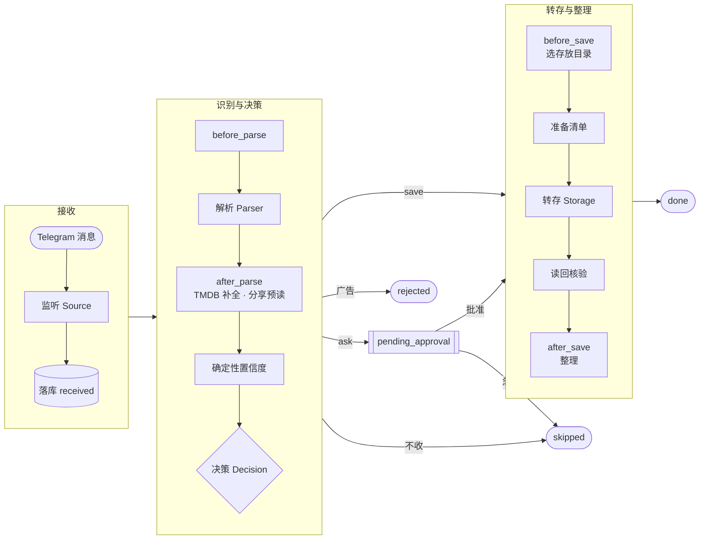
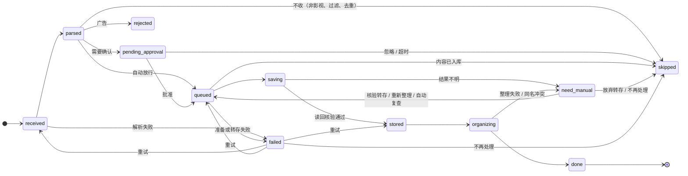

# 架构与可靠性设计

## 设计原则

1. **AI 提议，事实源校验，人工裁决，裁决结果反馈给 AI**：AI 负责理解与提议——读消息、抽字段、给出存不存与存到哪的建议、在规则无法确定时给方案、把一句话偏好起草成规则；TMDB、分享清单与配置校验等事实源和确定性规则负责把关；拿不准的交给你裁决；你的批准、忽略与修正记成样本，回流到识别示例、偏好判断与自动审批建议里。调用 115、写目录、去重始终由确定性代码完成，转存后读回核验。
2. **稳定内核 + 可插拔外围**：主流程是固定骨架，能力都是挂在扩展点上的插件（见 [插件开发指南](plugins.md)）。
3. **单一 Context 贯穿全程**：一条消息带着 `PipelineContext` 流经所有阶段，每次状态变更都持久化，可追溯、可恢复、可干预。
4. **失败隔离**：通知和事件先落库再独立投递；转存前置检查和整理失败会阻止任务完成，但不会拖垮其他任务。

## 一条消息的处理流程

## 任务状态机

进入 `failed` 的任务从记录的阶段（`retry_from`）重试：临时错误自动退避重试（`not_before`，不占并发槽，最多 3 次），分享失效、校验不通过这类重试也没用的只能人工重试。网盘暂时拒绝一切请求（如 115 风控冷却，冷却跨主进程重启保持）或推迟了这次请求（如上一个删除还没执行完）时，存储 Provider 抛 `StorageBusy`，表示请求没有执行：任务退回所在阶段、到点再领取，不算失败、不消耗重试次数。

- **审批态落库**：待确认任务持久化为 `pending_approval`，按钮 callback 只带任务 ID，进程重启后仍可点。
- **三层去重**：消息级（来源 + 消息 ID）、资源级（存储 Provider + 目标 CID + 分享码）、内容级（存储 Provider + 目标 CID + 作品 + 季 + 集）。剧集按集去重，同一分享链接追更新增的集仍会转存。作品身份见 `reelay/core/works.py`：两边都匹配到 TMDB 时按 TMDB ID 区分，否则按规范片名与年份，同名的不同作品（如翻拍剧）不会互相当成已入库；都不知道 TMDB ID 与年份时按同一部处理，宁可转人工也不重复转存。订阅放行、追更与缺集统计按同样的身份汇总已入库的集。放行判断时，识别可靠、TMDB 已匹配且消息里的集都已入库的直接跳过，不必等到批准后转存前才被拦下。
- **确定性校验失败**（集号无法识别、多季合集中有文件不带季号、同一集有多个文件、电影有多个正片候选）时先让 AI 给方案（`ai.assist`），方案经同一套规则校验通过才继续；否则在转存前停止，任务标记为不自动重试，修正后人工重试。

## AI 与规则的分工

| 能力 | AI 做什么 | 谁来把关 |
| --- | --- | --- |
| 识别（`providers/parser.py`） | 判类、抽字段与版本信息；参考同一来源最近的人工修正（`ai.examples`） | strict schema + 本地校验；分享码只由代码提取；TMDB 回填规范元数据；置信度由可核对信号计算 |
| 偏好判断（`decision: llm`） | 按一句话偏好与近期批准 / 忽略记录决定存不存 | 只能否决或转人工，不能越过过滤规则、置信度与人工确认；不决定保存位置（按来源的「保存到」与二级分类） |
| 订阅放行（`decision: subscription`） | —（订阅本身可由 AI 把一句话对应到 TMDB 条目，你确认后写入） | 只认 TMDB 匹配的同一条目同一季；消息与读取分享都不能确认只涉及这一季（如跨多季的合集）时不放行，消息没写季号时把季记为订阅的那一季、转存只取该季；置信度、过滤规则、分享清单与去重照常生效 |
| 转人工前兜底（`core/assist.py`） | 规则无法确定转存文件时给出季集映射（含多季合集里不带季号的文件）、多版本取舍、正片选择，以及消息只写了集数时选哪一季 | 交回同一套选集规则校验：不能与文件名冲突、不能丢掉某集全部文件、不能保留更差的版本、分段电影不能只选一段；不过仍转人工 |
| 一句话生成规则（`core/compiler.py`） | 把偏好起草成过滤、分类与版本偏好 | 按正式配置校验（不过时带错误重写一次），列出改动由你确认后写入；运行时只按规则判断 |
| 审批建议（`core/inbox.py`） | 把事实写成一句理由 | 事实（已入库的集、版本对比、订阅、识别可靠性）与建议动作都由规则决定 |
| 新来源接入、来源质量 | 起草来源规则；读统计与被拒样例给出调整建议 | 草案按正式配置校验并用样例试跑；建议的屏蔽词在批准过的消息里出现就丢弃；改动由你确认 |
| 失败解释、日报、控制 Bot 对话 | 把原因、统计写成话；理解一句话指令并调用查询工具 | 建议操作由规则决定；数字由代码统计；写操作只生成待确认计划，点「执行」后才调用服务层 |

人工裁决（批准、忽略、修正）统一记在 `feedback` 表（正文去掉链接与访问码），用于识别示例、偏好参考、按来源的通过率与「改为自动转存」建议，以及本地评测（`python -m reelay.eval`，样本只留在本地 `data/eval/`）。每次 AI 请求记入 `llm_calls`（用途、模型、耗时、token 与是否通过校验，保留 90 天），管理台「统计」可查看。所有 AI 调用失败时都按规则降级或转人工，不阻断主流程。

## 识别

- 调用 LLM 前先做确定性预过滤（无 115 链接、黑名单、缺 must_have），相同正文命中缓存，瞬时错误退避重试，非法输出重试一次；仍失败则降级 regex 并强制人工确认。
- 分享码与访问码只由确定性代码从正文和超链接中提取，不采信 LLM。
- 置信度由标题/类型/年份/TMDB 匹配等可核对信号计算（`reelay/core/confidence.py`），LLM 自报值仅保存在 `raw_fields.parser_confidence`。
- 发布版本信息（字幕、音轨、HDR、片源、编码、打包形式）由 LLM 一并抽取，规则从正文补上 LLM 漏掉的明确标记（`reelay/core/release.py`）。
- TMDB 按标题相似度与年份打分，最佳候选不可信时不改标题并转人工。

## 转存与恢复边界

`StorageProvider` 分为 `prepare`（列出分享、确定文件清单、建立独占暂存目录）、`save`（发送一次转存）、`reconcile`（只读核验）：

- 分享清单是集数的事实来源：剔除样片/预告/花絮，按文件名识别季集，排除目标目录中已入库的集。规则无法确定时先让 AI 给方案，方案经同一套规则校验后写入清单（每个文件带季集），整理沿用清单里的季集。
- 文件清单和 `receiving` 检查点必须在调用 115 写接口之前提交。115 没有可用的请求幂等键，发送前后中断时无法确认是否已执行，所以 `receiving` 恢复后**只核验、绝不重发**；空目录、部分落地、内容不符都进入 `need_manual`，由管理台"核验转存"重新读回；主进程也会在后台自动只读复查（5 分钟起、间隔加倍、最长 1 小时，24 小时后停止），覆盖 115 落地慢的情况。复查期间一般不发提醒；连续 3 次核验结果都没有变化（如一个文件都没到、只到了一部分）时提前提醒一次，后台仍继续复查；24 小时停止复查时，没提醒过的才通知。115 接受了转存请求、文件却迟迟没到时，它当时的回应写进任务轨迹，供排查。
- 落地文件按名称、数量、大小与可用 SHA1 完整核验，分别记录源文件与落地文件 ID。转存回执、去重记录与释放资源占位在同一事务内提交，之后整理可独立恢复。
- 资源占位（分享与集）在准备阶段获取；集数确定后如需占用的集正被其他任务持有，会释放全部占位再排队，避免互相等待；发送前重新核对其他任务是否已入库同一内容。
- 整理先持久化计划，再按文件 ID 执行建目录/改名/移动并读回核验；中断后按文件实际位置续跑。同名冲突按 `plugins.organizer.conflict` 处理，删除动作先记入扩展状态，重放不会重复删除。
- SQLite 使用 WAL + FULL 同步；数据库结构以 `PRAGMA user_version` 版本化迁移，版本高于程序时拒绝打开。

## 通知、事件与告警

- 通知与事件使用事务 Outbox：与任务状态在同一事务内写入，投递器独立重试（单次 30 秒超时，最多 8 次，支持 Telegram FloodWait；告警与恢复通知 24 小时内每分钟重试，Telegram 断开期间发不出的告警恢复后补发并注明发生时间），至少一次语义。已处理的审批和旧轮次通知不再推送。
- 系统通知（故障告警与恢复、审批汇总、日报）同样走 Outbox，进程重启不丢。告警按类别去重：状态由正常变为异常时通知一次，恢复时发送恢复通知。
- 115 cookie 缺失或失效、115 风控冷却期间暂停转存与整理的领取（解析照常），任务回到原阶段等待，不消耗重试次数，凭证恢复或冷却结束后自动继续。
- 消息源断开超过阈值告警（还没配置或登录 Telegram 时同样告警，消息源原地等待，补上后自动接上）。与 Telegram 断开后，监听与控制 Bot 在进程里用新的客户端重新连接，不用 Telethon 的自动重连（见 `core/telegram.py`：经透明代理时它看不出已经断开，网络恢复时还会被 Telegram 限流）。监听启动或重新连上时先记下每个来源已接收的最大消息 ID，再放行实时消息，然后补拉停机或断开期间的消息（最近 7 天、每个来源最多 200 条）；一个来源读取失败不影响其他来源。
- 已投递的通知与事件保留 7 天、投递失败的保留 30 天，每日巡检时清理；AI 调用记录保留 90 天。

## 配置与快照

任务接收时记下当时的配置版本号，审批、过滤、转发、路由、命名和扩展开关都按这个版本执行（配置本身按版本号只存一份，在 `config_snapshots` 表）：配置更新只影响新任务；「重新识别」「重新整理」改用当前配置，重新整理会按当前命名模板重新生成整理计划。目录别名在尚无转存检查点时解析为当前 CID，有检查点后绑定原 Provider、CID、清单与文件 ID。

订阅与「不再接收」的作品是用户数据，存在数据库里，不属于配置：追剧、取消订阅不会改变配置版本，也不会和正在编辑的设置页冲突。

## 进程模型

- `python -m reelay.main`：消息源 + Worker + 控制 Bot，单实例（数据库旁的文件锁阻止两个 Worker 消费同一数据库）。还没配置 Telegram 时照常运行，消息源等待配置，管理台显示原因。
- `python -m reelay.main --dry-run`：内置配置 + 样例消息 + 内存网盘走一遍完整流程，不读本机配置与密钥、不访问网络。
- `python -m reelay.web`：管理 API 与前端，只读写任务状态，不启动 Worker。
- `python -m reelay.mcp_server`：MCP 的 stdio 接入，与 Web 相同的服务层；Web 进程也在 `/mcp` 提供同一组工具（Streamable HTTP，凭 MCP 访问令牌）。工具的定义、参数校验与实现在 `reelay/agent_tools.py`，控制 Bot 的对话助手也从这里取工具，区别只在写操作何时执行：MCP 直接执行（客户端按工具标注确认），对话助手先列出来，用户点「执行」后才执行。

三者共享同一个 SQLite 数据库与配置文件；Web/MCP 修改配置后，Worker 约 1 秒内采用。各组件的心跳写在同一数据库里，内容不变时最多 10 秒写一次。
