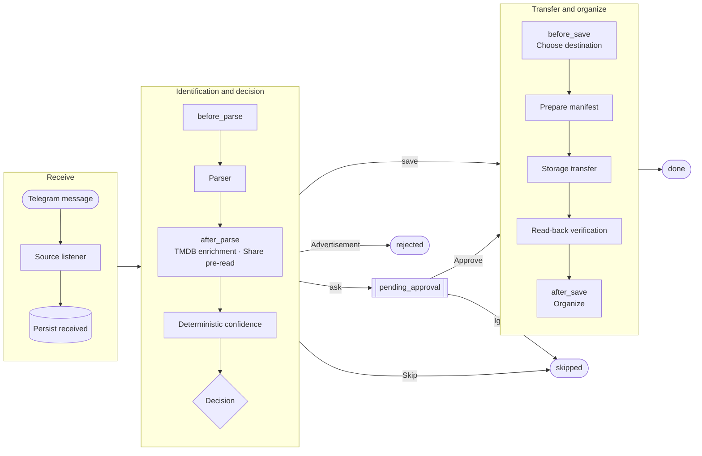
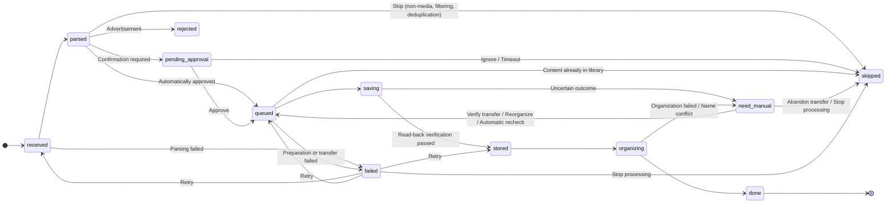

# Architecture and Reliability

## Design Principles

1. **AI proposes, authoritative data validates, humans decide, and decisions feed back into AI**: AI handles interpretation and proposals—reading messages, extracting fields, suggesting whether and where to save, proposing solutions when rules cannot decide, and drafting rules from a natural-language preference. Authoritative data such as TMDB and share manifests, together with deterministic rules and configuration validation, provide the checks. Uncertain cases go to you. Your approvals, ignores, and corrections become examples for identification, preference decisions, and suggestions to enable automatic approval. Calls to 115, directory writes, and deduplication always use deterministic code, with read-back verification after transfers.
2. **A stable core with pluggable components**: the main workflow is a fixed skeleton; capabilities are plugins attached to extension points. See the [Plugin development guide](plugins.md).
3. **One context throughout the workflow**: each message carries a `PipelineContext` through every stage. Every state change is persisted, making tasks traceable, recoverable, and available for manual intervention.
4. **Failure isolation**: notifications and events are persisted first, then delivered independently. Failed transfer prechecks and organization prevent the affected task from completing, but do not bring down other tasks.

## How a Message Is Processed

## Task State Machine

Tasks in `failed` retry from the recorded stage (`retry_from`). Transient errors retry automatically with backoff (`not_before`), without occupying a concurrency slot, up to 3 times. Errors that retries cannot resolve, such as expired shares or failed validation, require a manual retry. When the drive temporarily refuses all requests, such as a 115 protection cooldown that persists across main-process restarts, or defers the current request, such as waiting for an earlier deletion to finish, the storage Provider raises `StorageBusy`. This means the request was not executed: the task returns to its current stage and becomes eligible again at the specified time, without being counted as a failure or consuming a retry.

- **Durable approval state**: tasks awaiting confirmation are persisted as `pending_approval`. Button callbacks carry only a task ID, so buttons still work after process restarts.
- **Subscriptions only**: available since **v1.5.0**, `subscriptions_only` is off by default and can be set globally or overridden per source. When enabled, `Pipeline.decide` checks the title and season against active subscriptions before calling the decision Provider, and ignores unmatched resources immediately. Production identification and test previews share this entry point, so subscription auto-approval, AI preferences, and custom decision Providers cannot admit unsubscribed resources.
- **Three layers of deduplication**: message-level (source + message ID), resource-level (storage Provider + destination CID + share code), and content-level (storage Provider + destination CID + work + season + episode). Series are deduplicated per episode, so new episodes added to the same share link can still be saved. Work identity is defined in `reelay/core/works.py`: use the TMDB ID when both sides have a TMDB match; otherwise use the normalized title and year. Different works with the same name, such as remakes, are not mistaken for each other. If neither TMDB ID nor year is known, treat them as the same work, preferring manual review over duplicate transfers. Subscription auto-approval, episode tracking, and missing-episode statistics aggregate stored episodes using the same identity. During the decision stage, a reliably identified, TMDB-matched message whose episodes are all in the library is skipped immediately, rather than waiting until after approval and just before transfer.
- **Failed deterministic validation**, such as unrecognized episode numbers, files without season numbers in a multi-season collection, multiple files for one episode, or multiple main-feature candidates for a movie, first asks AI for a proposal (`ai.assist`). Processing continues only if that proposal passes the same rule validation. Otherwise the task stops before transfer, is marked as ineligible for automatic retries, and requires correction followed by a manual retry.

## Responsibilities of AI and Rules

| Capability | What AI does | What enforces the boundary |
| --- | --- | --- |
| Identification (`providers/parser.py`) | Classify resources and extract fields and release information, using recent manual corrections from the same source as examples (`ai.examples`) | Strict schema and local validation; share codes extracted only by code; normalized metadata supplied by TMDB; confidence calculated from verifiable signals |
| Preference decisions (`decision: llm`) | Decide whether to save using natural-language preferences and recent approvals / ignores. For new episodes eligible for subscription auto-approval, AI is told they are subscribed and should allow them unless a preference explicitly excludes them | Can only veto or request manual review; cannot bypass filters, confidence checks, or manual confirmation. Does not choose destinations, which follow the source's “保存到” (Save to) setting and category rules |
| Subscription auto-approval (`decision: subscription`) | None; AI may resolve a natural-language subscription request to a TMDB entry, which is saved only after your confirmation | Requires the same TMDB-matched entry and season. No auto-approval if neither the message nor a share inspection can confirm that only this season is involved, as with a multi-season collection. If the message omits the season, record the subscribed season and transfer only that season. Confidence, filters, manifests, and deduplication still apply |
| Assistance before manual intervention (`core/assist.py`) | Propose season/episode mappings, including files without season numbers in multi-season collections; choose between versions and main-feature candidates; choose a season when a message lists only episode numbers | Revalidate with the same file-selection rules: no contradictions with filenames, no dropping all files for an episode, no keeping an inferior version, and no selecting only one part of a multipart movie. Failed validation still goes to manual intervention |
| Rules from natural language (`core/compiler.py`) | Draft filtering, classification, and release-preference rules from a preference | Validate as production configuration, with one rewrite using the errors if invalid; show the changes and save only after your confirmation. Runtime decisions use rules alone |
| Approval advice (`core/inbox.py`) | Turn facts into a short explanation | Rules determine both the facts—stored episodes, version comparison, subscriptions, and identification reliability—and the suggested action |
| New-source setup and source quality | Draft source rules; read statistics and rejected examples to suggest adjustments | Validate drafts as production configuration and test them on examples. Discard suggested blocked keywords that appear in approved messages. Changes require your confirmation |
| Failure explanations, daily reports, and control Bot conversations | Explain causes and statistics; understand natural-language commands and call query tools | Rules determine suggested actions; code calculates numbers. Writes produce a pending plan only, and call the service layer only after you click “执行” (Execute) |

Manual decisions—approvals, ignores, and corrections—are recorded in the `feedback` table with links and access codes removed from message text. They support identification examples, preference context, per-source approval rates, suggestions to “改为自动转存” (Switch to automatic saving), and local evaluation (`python -m reelay.eval`, with samples kept only in local `data/eval/`). Each AI request is recorded in `llm_calls`, including purpose, model, duration, tokens, and validation result, and retained for 90 days. The web console's “统计” (Statistics) page displays these records. Failed AI calls fall back to rules or manual review rather than blocking the main workflow.

## Identification

- Before calling the LLM, deterministic prefilters reject messages with neither a 115 share nor an ed2k link, blocked keywords, or missing `must_have` terms. Identical message text uses the cache. Transient errors retry with backoff, and invalid output is retried once; continued failure falls back to regex and forces manual confirmation.
- Share codes, access codes, and ed2k links are extracted only by deterministic code from message text, hyperlinks, and message buttons, including link-button URLs and “复制” (Copy) button contents. LLM output is not trusted for these values. If a message contains both a 115 share and ed2k links, only the share is transferred.
- Confidence is calculated from verifiable signals such as title, type, year, and TMDB matching (`reelay/core/confidence.py`). The LLM's self-reported score is retained only in `raw_fields.parser_confidence`.
- The LLM also extracts release information: subtitles, audio tracks, HDR, source, codecs, and packaging. Rules supplement explicit markers in the text that the LLM missed (`reelay/core/release.py`).
- TMDB candidates are scored by title similarity and year. If the best candidate is not trustworthy, the title remains unchanged and the task goes to manual review.

## Transfer and Recovery Boundaries

`StorageProvider` separates `prepare` (list the share, determine the file manifest, create an exclusive staging directory), `save` (send one transfer request), and `reconcile` (read-only verification):

- The share manifest is the authoritative source for episodes: remove samples, trailers, and extras; identify seasons and episodes from filenames; exclude episodes already in the destination library. If rules cannot decide, ask AI for a proposal, validate it with the same rules, and write the accepted per-file seasons and episodes into the manifest. Organization uses those recorded values.
- Commit the file manifest and `receiving` checkpoint **before calling any 115 write API**. 115 provides no usable request idempotency key, so an interruption around sending leaves execution uncertain. On recovery from `receiving`, **verify only; never resend**. An empty directory, partial arrival, or mismatched content moves the task to `need_manual`, where “核验转存” (Verify transfer) in the console reads the result back again. The main process also performs automatic read-only background checks to accommodate slow arrivals: start after 5 minutes, double the interval up to 1 hour, and stop after 24 hours. Checks are normally silent; 3 consecutive unchanged results, such as no files or only some files having arrived, trigger one early reminder while checks continue. At the 24-hour cutoff, notify only if no reminder was sent earlier. If 115 accepted the request but files are slow to arrive, its response is written to the task trace for diagnosis.
- Verify received files completely by name, count, size, and SHA1 where available, recording both source and received file IDs. Commit the transfer receipt, deduplication records, and release of resource claims in the same transaction. Organization can then recover independently.
- Resource claims for shares and episodes are acquired during preparation. Once episodes are known, if another task holds a required episode claim, release all claims and requeue to avoid mutual waiting. Before sending, check again whether another task has already stored the same content.
- Organization persists its plan before creating directories, renaming, and moving by file ID, with read-back verification. After interruption, resume from each file's actual location. Handle name conflicts according to `plugins.organizer.conflict`; record deletion actions in extension state before execution so replay does not delete twice.
- Messages containing only ed2k links, without a 115 share, use 115 cloud downloads. Filenames and sizes in the links form the manifest and use the same episode-selection rules as shares. `save` adds the selected links as cloud-download tasks into an exclusive staging directory. `reconcile` reads the staging directory back; if files are incomplete, it checks the cloud-download tasks. While downloading, record progress and continue background checks; if downloading failed and no files arrived, stop retrying. 115 permits only one task per link: if an earlier task completed or failed, delete its record, not its files, before adding a new one; if it is still downloading, retry later. After verification passes, delete this transfer's cloud-download task records. Resource-level deduplication uses a hash of the links.
- SQLite uses WAL with FULL synchronization. Database schemas use versioned migrations through `PRAGMA user_version`; a program refuses to open a schema newer than it supports.

## Notifications, Events, and Alerts

- Notifications and events use a transactional Outbox, written in the same transaction as task state. A separate dispatcher retries delivery with a 30-second timeout per attempt, up to 8 attempts, and support for Telegram FloodWait. Alerts and recovery notifications retry every minute for up to 24 hours. Alerts that could not be sent while Telegram was disconnected are delivered after reconnection with their original occurrence time. Delivery is at least once. Notifications for already-handled approvals or old processing rounds are no longer sent.
- System notifications—failure and recovery alerts, approval digests, and daily reports—also use the Outbox and survive process restarts. Alerts are deduplicated by category: notify once when a healthy state becomes unhealthy, then send a recovery notification when it recovers.
- Missing or expired 115 cookies and 115 protection cooldowns pause task pickup for transfers and organization, while parsing continues. Tasks return to their original stage without consuming retries and resume automatically when credentials recover or the cooldown ends.
- A disconnected message source triggers an alert after the configured threshold. This also applies before Telegram is configured or logged in: the source waits and connects automatically once ready. After a Telegram disconnect, the listener and control Bot reconnect inside the process with new clients rather than Telethon's automatic reconnection. See `core/telegram.py`: with transparent proxies, Telethon may fail to detect the disconnection and then trigger Telegram rate limiting as the network recovers. When monitoring starts or reconnects, first record the highest received message ID for each source, then allow live messages, and finally backfill messages missed during downtime or disconnection, up to 200 per source from the last 7 days. A failure to read one source does not affect others.
- Delivered notifications and events are retained for 7 days, failed deliveries for 30 days, and cleaned up during daily inspection. AI call records are retained for 90 days.

## Configuration and Snapshots

Each task records the configuration version active when it was received. Approval, filtering, forwarding, routing, naming, and extension switches all use that version. Each configuration version is stored only once, in `config_snapshots`, so configuration updates affect new tasks only. “重新识别” (Re-identify) and “重新整理” (Reorganize) switch to the current configuration; reorganizing regenerates its plan with the current naming templates. Before a transfer checkpoint exists, directory aliases resolve to the current CID. After a checkpoint exists, the task remains bound to its original Provider, CID, manifest, and file IDs.

Subscriptions and titles marked “不再接收” (Stop receiving) are user data stored in the database, not configuration. Subscribing or unsubscribing does not change the configuration version or conflict with a settings page being edited.

## Process Model

- `python -m reelay.main`: message source + Worker + control Bot, single instance. A file lock beside the database prevents two Workers from consuming the same database. It runs even before Telegram is configured; the source waits for configuration and the console displays the reason.
- `python -m reelay.main --dry-run`: run the complete workflow with built-in configuration, sample messages, and an in-memory drive. It reads no local configuration or secrets and makes no network requests.
- `python -m reelay.web`: management API and frontend; reads and writes task state without starting a Worker.
- `python -m reelay.mcp_server`: MCP over stdio, using the same service layer as the Web process. The Web process also serves the same tools at `/mcp` using Streamable HTTP and MCP access tokens. Tool definitions, argument validation, and implementations live in `reelay/agent_tools.py`, and the control Bot's conversational assistant uses them too. The difference is when writes execute: MCP executes directly, with the client handling confirmation based on tool annotations; the conversational assistant first lists a plan and executes only after the user clicks “执行” (Execute).

The three services share one SQLite database and the same configuration files. After Web/MCP changes configuration, the Worker adopts it in about 1 second. Component heartbeats are written to the same database, at most once every 10 seconds when their contents are unchanged.
